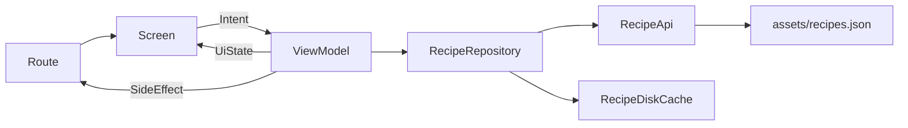

# RecipeBox

A native Android app for browsing, searching, and filtering cooking recipes, built with **Kotlin** and **Jetpack Compose**. Recipe data is loaded from a bundled JSON file that is treated as if it were a real search API.

## Features

- Browse recipes in a responsive, adaptive grid or list.
- Full-text search across recipe **titles, descriptions, and cooking instructions**.
- Filters:
  - Vegetarian only
  - Servings range (min/max)
  - Must-include ingredients
  - Must-not-include ingredients
- Rich recipe detail screen with ingredients and numbered instructions.
- **Offline-first**: recipe JSON is cached to disk after the first load; food photos are bundled in `assets/images/` so the app works without network.
- Smooth motion: shared-element transition from list card to detail, crossfading images, press feedback on cards, and animated grid re-ordering as filters change.

## Setup

Requirements: Android Studio (latest stable) with JDK 11+ and an Android SDK that includes API 36.

```bash
# Build a debug APK
./gradlew assembleDebug

# Run the unit tests (search/filter + JSON parsing)
./gradlew testDebugUnitTest
```

The generated APK is at `app/build/outputs/apk/debug/app-debug.apk`. Open the project in Android Studio and run the `app` configuration on an emulator/device (min SDK 26).

> Recipe photos are shipped inside `app/src/main/assets/images/` and referenced via `imageAsset` in `recipes.json`, so list and detail screens work fully offline. Coil still keeps a disk cache for any remote `imageUrl` fallback.

## Architecture

The app follows **MVVM with a light MVI shell** (ViaUnica-inspired, single-module): sealed `Intent` → ViewModel reducer → immutable `UiState` + one-shot `SideEffect`s. Screens stay dumb (`state` + `onIntent` only).

```
Route (collect state/effects) -> Screen(state, onIntent) -> ViewModel.onIntent
ViewModel -> RecipeRepository -> RecipeApi -> assets/recipes.json
                       \-> RecipeCache (filesDir)  [offline fallback]
Images: assets/images/*.jpg via imageAsset (Coil + disk cache)
```



### Package layout (`com.tharsis.recipebox`)

| Package | Responsibility |
|---------|----------------|
| `core/config` | Non-UI constants (`AppConfig`) — debounce, cache paths, image sizes. |
| `data/model` | Clean domain models (`Recipe`, `DietaryAttributes`). |
| `data/api` | `RecipeApi` contract, `LocalRecipeApi`, `RecipeFilter`, `AssetReader`. |
| `data/api/dto` | Serialization DTOs + mappers. |
| `data/repository` | Offline-first `RecipeRepository`. |
| `data/cache` | `RecipeCache` / `RecipeDiskCache`. |
| `di` | Koin `appModule`. |
| `ui/theme` | Color, Type, Theme, `Spacing` tokens. |
| `ui/list` | Intent / UiState / SideEffect / ViewModel / Screen + cards/filters. |
| `ui/detail` | Intent / UiState / SideEffect / ViewModel / Screen. |
| `ui/components` | Shared composables. |
| `ui/navigation` | `RecipeNavHost` + routes. |
| `ui/preview` | Static sample data for `@Preview`. |

### Why this shape

Even though data comes from a local file, the data layer is modeled as a suspendable, query-driven API (`RecipeApi.searchRecipes(query)`). Swapping the bundled JSON for a real backend is a one-line change in `di/AppModule.kt`, no UI or ViewModel changes required. We intentionally **did not** split into multi-modules or a full design-system library — that would be overkill for this challenge.

## Key design decisions

- **Intent / UiState / SideEffect.** List and detail ViewModels expose a single `onIntent` entry and emit navigation as side effects (Channel), matching the ViaUnica PDP pattern without its module graph.
- **No hardcoded UI copy / magic numbers.** User-facing strings live in `strings.xml`; spacing/radii in `Spacing`; timings and file names in `AppConfig`.
- **Koin for DI.** The detail ViewModel receives its recipe id as a Koin parameter from the navigation argument.
- **kotlinx.serialization** for JSON. A DTO layer keeps the JSON contract decoupled from the domain model.
- **Search modeled as an endpoint.** Pure `RecipeFilter` is unit-testable and identical to what a server-side search would return.
- **Coil 3** with memory + disk cache; bundled `imageAsset` photos load offline.
- **Offline recipe cache.** `RecipeRepository` persists each successful API payload via `RecipeDiskCache`.
- **R8 for release.** `minifyEnabled` + `shrinkResources` with focused ProGuard keeps for serialization / Coil / Koin.
- **Formatting.** `.editorconfig` + Spotless (ktlint) — run `./gradlew spotlessApply`.
- **Native Compose motion** (no extra animation SDK): `SharedTransitionLayout` for the list→detail hero transition, `animateItem()` for grid changes, press-scale on cards, and nav fade/slide transitions. Search input is debounced (250 ms) so results update smoothly while typing.

## Filter semantics

- **Text**: case-insensitive substring match against title + description + instructions.
- **Include ingredients**: a recipe must contain **all** listed ingredients (substring match).
- **Exclude ingredients**: a recipe must contain **none** of the listed ingredients.
- **Servings**: inclusive `min`/`max`. A full-range slider (1–12) means "no servings filter".
- Multiple filters combine with **AND** semantics.

## Assumptions & tradeoffs

- The bundled `assets/recipes.json` plays the role of an API response; parsing happens once and is cached in memory, then mirrored to disk via `RecipeDiskCache`.
- Filtering is done in memory over the full list. For a real backend this would move server-side with pagination; it's intentionally simple here since the dataset is small.
- Recipe photos are bundled under `assets/images/` (`imageAsset`) so the UI works offline; optional `imageUrl` remains as a remote fallback.
- Dietary attributes are modeled as explicit booleans for type-safe filtering. Only the vegetarian filter is surfaced in the UI, but the model supports more.

## Known limitations

- No favorites / history persistence beyond the recipe catalog cache.
- No server-side pagination/sorting; the full collection is loaded at once.
- Text search is substring-based (no fuzzy matching or ranking).
- Instrumented UI tests are not included; coverage focuses on search/filter, DTO mapping, and repository cache fallbacks.

## Tech stack

Kotlin · Jetpack Compose (Material 3) · Koin · kotlinx.serialization · Coroutines/Flow · Navigation Compose · Coil 3
