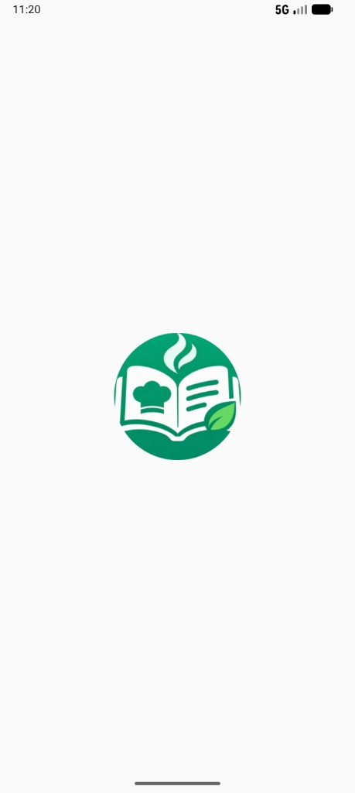
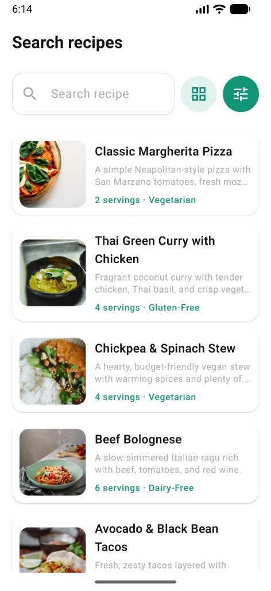
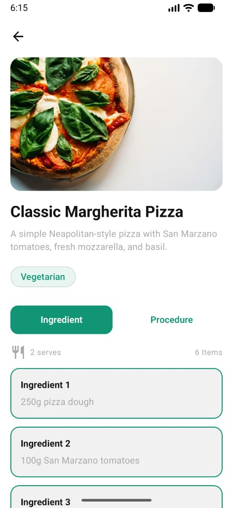
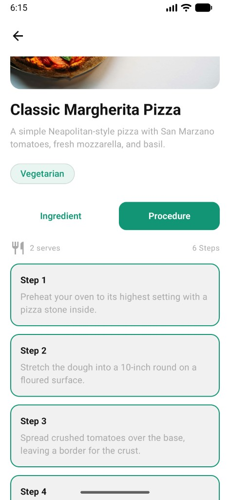
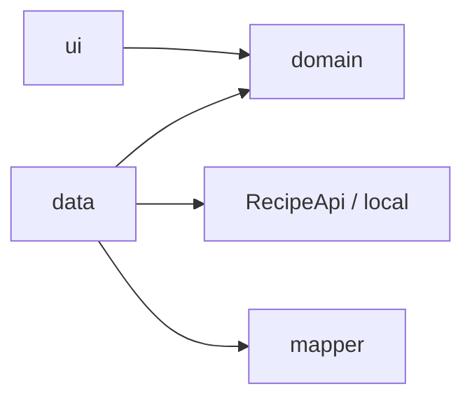

# RecipeBox

<div style="text-align: center">



</div>

A native Android app for browsing, searching, and filtering cooking recipes, built with **Kotlin** and **Jetpack Compose**. Recipe data is loaded from a bundled JSON file that is treated as if it were a real search API.

## Screenshots

| Home (grid) | Home (list) | Filters |
|:---:|:---:|:---:|
|  |  |  |

| Detail · Ingredients | Detail · Procedure |
|:---:|:---:|
|  |  |

## Features

- Browse recipes in a responsive, adaptive grid or list.
- Full-text search across recipe **titles, descriptions, and cooking instructions**.
- Filters:
  - Vegetarian only
  - Servings range (min/max)
  - Must-include ingredients
  - Must-not-include ingredients
- Rich recipe detail screen with ingredients and numbered instructions.
- **Offline-first**: recipe JSON is cached to disk after the first load; food photos are bundled in `assets/images/` so the app works without network.
- Smooth motion: shared-element transition from list card to detail, crossfading images, press feedback on cards, and animated grid re-ordering as filters change.

## Setup

Requirements: Android Studio (latest stable) with JDK 11+ and an Android SDK that includes API 36.

```bash
# Build a debug APK
./gradlew assembleDebug

# Run the unit tests (search/filter + JSON parsing)
./gradlew testDebugUnitTest
```

The generated APK is at `app/build/outputs/apk/debug/app-debug.apk`. Open the project in Android Studio and run the `app` configuration on an emulator/device (min SDK 26).

> Recipe photos are shipped inside `app/src/main/assets/images/` and referenced via `imageAsset` in `recipes.json`, so list and detail screens work fully offline. Coil still keeps a disk cache for any remote `imageUrl` fallback.

## Architecture

The app follows **MVVM + minimal Clean Architecture** with a light MVI shell (ViaUnica-inspired, single-module): sealed `Intent` → ViewModel → immutable `UiState` + `SideEffect`s. Dependencies point inward: **ui → domain ← data**.

```
UI (Route/Screen/VM) -> domain.RecipeRepository
                           ↑
data.RecipeRepositoryImpl -> RecipeApi / RecipeCache
RecipeDto --mapper--> domain.Recipe
```



### Package layout (`com.tharsis.recipebox`)

| Package | Responsibility |
|---------|----------------|
| `core` | Non-UI constants (`AppConfig`). |
| `domain/model` | Pure Kotlin models (`Recipe`, `RecipeSearchQuery`, `RecipeFilter`). |
| `domain/repository` | `RecipeRepository` **interface** only. |
| `data/api` | `RecipeApi`, `LocalRecipeApi`, `dto/` (`@Serializable`). |
| `data/local` | `AssetReader`, `RecipeCache` / `RecipeDiskCache`. |
| `data/mapper` | DTO ↔ domain mapping. |
| `data/repository` | `RecipeRepositoryImpl` (offline-first). |
| `di` | Koin `appModule`. |
| `ui/*` | Per-feature screens (list/detail), theme, components, navigation. |

No use-case layer — intentional for a small catalog (same stance as Now in Android).

### Why this shape

The data layer is a suspendable, query-driven API so a real backend is a one-line swap in `AppModule`. Domain stays annotation-free; serialization stays on DTOs.

## Key design decisions

- **Clean-ish dependency rule.** UI depends on `domain`; `data` implements domain contracts and owns DTOs/mappers.
- **Intent / UiState / SideEffect.** ViaUnica-style presentation without multi-module ceremony.
- **No hardcoded UI copy / magic numbers.** `strings.xml`, `Spacing`, `AppConfig`.
- **Koin for DI.** Detail ViewModel receives recipe id as a parameter.
- **Pure `RecipeFilter` in domain.** Unit-tested search semantics, identical to a server-side filter.
- **Coil 3** + bundled `imageAsset` photos (offline). Disk catalog cache warms once per process.
- **R8 for release** + Spotless/ktlint formatting.

## Filter semantics

- **Text**: case-insensitive substring match against title + description + instructions.
- **Include ingredients**: a recipe must contain **all** listed ingredients (substring match).
- **Exclude ingredients**: a recipe must contain **none** of the listed ingredients.
- **Servings**: inclusive `min`/`max`. A full-range slider (1–12) means "no servings filter".
- Multiple filters combine with **AND** semantics.

## Assumptions & tradeoffs

- The bundled `assets/recipes.json` plays the role of an API response; parsing happens once and is cached in memory, then mirrored to disk via `RecipeDiskCache`.
- Filtering is done in memory over the full list. For a real backend this would move server-side with pagination; it's intentionally simple here since the dataset is small.
- Recipe photos are bundled under `assets/images/` (`imageAsset`) so the UI works offline; optional `imageUrl` remains as a remote fallback.
- Dietary attributes are modeled as explicit booleans for type-safe filtering. Only the vegetarian filter is surfaced in the UI, but the model supports more.

## Known limitations

- No favorites / history persistence beyond the recipe catalog cache.
- No server-side pagination/sorting; the full collection is loaded at once.
- Text search is substring-based (no fuzzy matching or ranking).
- Instrumented UI tests are not included; coverage focuses on search/filter, DTO mapping, and repository cache fallbacks.

## Tech stack

Kotlin · Jetpack Compose (Material 3) · Koin · kotlinx.serialization · Coroutines/Flow · Navigation Compose · Coil 3
