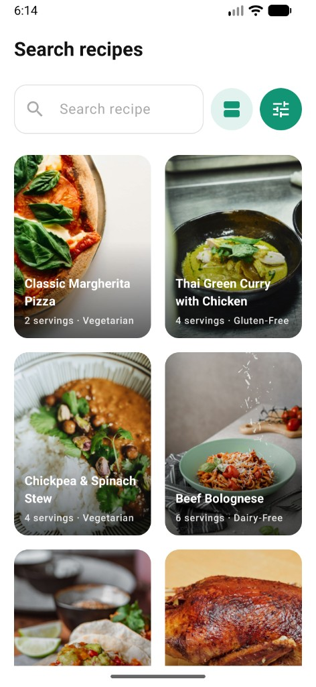
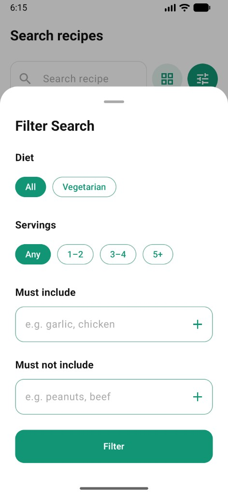
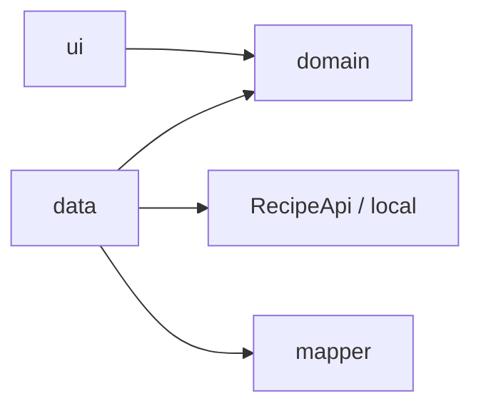

# RecipeBox

<p style="text-align: center">
  
</p>

A native Android app for browsing, searching, and filtering cooking recipes, built with **Kotlin** and **Jetpack Compose**. Recipe data is loaded from a bundled JSON file that is treated as if it were a real search API.

## Screenshots

| Home (grid) | Home (list) | Filters |
|:---:|:---:|:---:|
|  |  |  |

| Detail · Ingredients | Detail · Instructions |
|:---:|:---:|
|  |  |

## Features

- Browse recipes in a **grid** or **list** layout (toggle in the search bar).
- Full-text search across recipe **titles, descriptions, and cooking instructions**.
- Filters:
  - Vegetarian only
  - Servings range (min/max)
  - Must-include ingredients
  - Must-not-include ingredients
- Detail screen with hero image, dietary chips, sticky **Ingredients / Instructions** switcher, and compact list rows.
- **Offline-first**: recipe JSON is cached to disk after the first load; food photos are bundled in `assets/images/` so the app works without network.
- Smooth motion: shared-element transition from list card to detail, crossfading images, and animated layout changes as filters update.

## Setup

Requirements: Android Studio (latest stable) with **JDK 11+** and an Android SDK that includes **API 37**.

```bash
# Build a debug APK
./gradlew assembleDebug

# Run the unit tests (search/filter + JSON parsing + repository cache)
./gradlew testDebugUnitTest
```

The generated APK is at `app/build/outputs/apk/debug/app-debug.apk`. Open the project in Android Studio and run the `app` configuration on an emulator/device (**min SDK 26**).

> Recipe photos ship in `app/src/main/assets/images/` and are referenced via `imageAsset` in `recipes.json`, so list and detail screens work fully offline. Domain models expose a Coil-ready `imageUri` (asset URI preferred; remote `imageUrl` only if the asset is missing).

## High-level architecture overview

The app follows **MVVM + minimal Clean Architecture** with a light MVI shell (single-module): sealed `Intent` → ViewModel → immutable `UiState` + one-shot `SideEffect`s. Dependencies point inward: **ui → domain ← data**.

```
UI (Route/Screen/VM) -> domain.RecipeRepository
                           ↑
data.RecipeRepositoryImpl -> RecipeApi / RecipeCache
RecipeDto --mapper--> domain.Recipe
```



### Package layout (`com.tharsis.recipebox`)

| Package | Responsibility |
|---------|----------------|
| `core` | Non-UI constants (`AppConfig`). |
| `domain/model` | Pure Kotlin models (`Recipe`, `RecipeSearchQuery`, `RecipeCatalogFilter`). |
| `domain/repository` | `RecipeRepository` **interface** only. |
| `data/api` | `RecipeApi`, `LocalRecipeApi`, `dto/` (`@Serializable`). |
| `data/local` | `AssetReader`, `RecipeCache` / `RecipeDiskCache`. |
| `data/mapper` | DTO ↔ domain mapping (`imageAsset`/`imageUrl` → `imageUri`). |
| `data/repository` | `RecipeRepositoryImpl` (offline-first). |
| `di` | Koin `appModule`. |
| `ui/*` | Per-feature screens (list/detail), theme, components, navigation. |

No use-case layer — intentional for a small catalog (same stance as Now in Android).

## Key design decisions

- **Clean-ish dependency rule.** UI depends on `domain`; `data` implements domain contracts and owns DTOs/mappers.
- **Intent / UiState / SideEffect.** UI events enter via sealed intents; navigation leaves as one-shot side effects so the ViewModel stays free of `NavController`.
- **No hardcoded UI copy / magic numbers.** User-facing strings live in `strings.xml`; spacing in `Spacing`; knobs in `AppConfig`.
- **Koin for DI.** Detail ViewModel receives recipe id as a constructor parameter from navigation.
- **Pure `RecipeCatalogFilter` in domain.** Unit-tested search semantics, identical to what a server-side filter would do.
- **Coil 3** + bundled `imageAsset` photos (offline). Memory cache only — no Coil disk cache, because assets are already on device.
- **Recipe catalog disk cache** warms once per process via `RecipeDiskCache` so a failed re-read of assets can still serve the last good catalog.
- **R8 for release** builds.
- **Always-light Material 3 theme** with brand green (`#129575`).

## Filter semantics

- **Text**: case-insensitive substring match against title + description + instructions.
- **Include ingredients**: a recipe must contain **all** listed ingredients (substring match).
- **Exclude ingredients**: a recipe must contain **none** of the listed ingredients.
- **Servings**: inclusive `min`/`max`. A full-range slider (1–12) means "no servings filter".
- Multiple filters combine with **AND** semantics.

## Assumptions and tradeoffs

- The bundled `assets/recipes.json` plays the role of an API response; parsing happens once and is cached in memory, then mirrored to disk via `RecipeDiskCache`.
- Filtering is done in memory over the full list. For a real backend this would move server-side with pagination; it's intentionally simple here since the dataset is small.
- Recipe photos are bundled under `assets/images/` (`imageAsset`) so the UI works offline; optional `imageUrl` remains as a remote fallback when `imageAsset` is absent.
- Domain uses `imageUri` (not `imageUrl`) because the resolved value may be a `file:///android_asset/...` URI, not an HTTP URL.
- Dietary attributes are modeled as explicit booleans for type-safe filtering. Only the vegetarian filter is surfaced in the UI, but the model supports vegan / gluten-free / dairy-free for badges and future filters.
- `RecipeApi` returns domain `Recipe` (not DTOs) to keep the "API port" convenient for ViewModels; DTOs stay inside the data layer at the serialization boundary.

## Known limitations

- No favorites / history persistence beyond the recipe catalog cache.
- No server-side pagination/sorting; the full collection is loaded at once.
- Text search is substring-based (no fuzzy matching or ranking).
- Instrumented UI tests are not included; coverage focuses on search/filter, DTO mapping, and repository cache fallbacks.
- Several sample Unsplash links in JSON are photo *pages*, not direct image files — harmless today because every recipe has an `imageAsset`.

## Tech stack

Kotlin · Jetpack Compose (Material 3) · Koin · kotlinx.serialization · Coroutines/Flow · Navigation Compose · Coil 3
